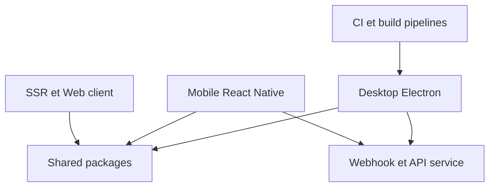

# RSSNext/Folo

> Open source RSS reader with AI (summaries, translation, scheduled tasks), for people who follow many sources.

## The problem
Following dozens of blogs, newsletters and channels means reading everything or losing the information.

## What it actually does
Aggregates RSS, Atom, JSON and RSSHub routes into a single timeline. The AI answers questions about an article, a feed or a folder, summarizes the timeline, translates (English, Chinese, Japanese, French) and reads aloud. Scheduled tasks write briefings sent by chat or email. Exports to Obsidian, Readwise, Zotero and others.

## How it is wired


## Trying it
```bash
# Aucune commande dans le README.
# Applications bureau (Windows, macOS) et mobiles (iPhone, iPad, Android).
```

## Cost and gotchas
Free, no ads. The AI model is chosen in the application or with your own API key. AGPL-3.0 license: obligations if you modify and expose the code.

## What it is not
Not just a local reader: the AI features depend on a service. What the server does is not detailed in the README.

## Alternatives
No alternative named in the README.

## For you
Worth watching: useful for your daily monitoring (OPML, summaries, scheduled tasks), but the AGPL and the AI service call for a trial before adoption.
