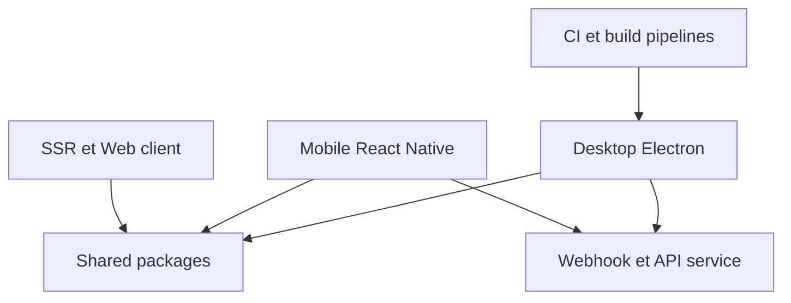

# RSSNext/Folo

> Lecteur RSS open source avec IA (résumés, traduction, tâches planifiées), pour qui suit beaucoup de sources.

## Le problème
Suivre des dizaines de blogs, newsletters et chaînes demande de tout lire ou de perdre l'information.

## Ce que ça fait vraiment
Agrège RSS, Atom, JSON et routes RSSHub en une chronologie. L'IA répond sur un article, un flux ou un dossier, résume la chronologie, traduit (anglais, chinois, japonais, français) et lit à voix haute. Des tâches planifiées écrivent des briefings envoyés par chat ou courriel. Exports vers Obsidian, Readwise, Zotero et d'autres.

## Comment c'est branché


## Essayer
```bash
# Aucune commande dans le README.
# Applications bureau (Windows, macOS) et mobiles (iPhone, iPad, Android).
```

## Coût et pièges
Gratuit, sans publicité. Le choix du modèle d'IA se fait dans l'application ou avec ta propre clé d'API. Licence AGPL-3.0 : obligations si tu modifies et exposes le code.

## Ce que ce n'est pas
Pas un simple lecteur local : les fonctions IA dépendent d'un service. Ce que fait le serveur n'est pas détaillé dans le README.

## Alternatives
Aucune alternative nommée dans le README.

## Pour toi
À surveiller : utile pour ta veille quotidienne (OPML, résumés, tâches planifiées), mais l'AGPL et le service d'IA demandent un essai avant adoption.

