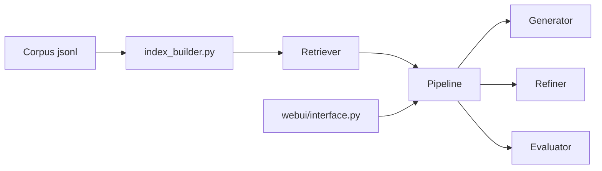

# RUC-NLPIR/FlashRAG

> Python toolkit to reproduce and compare RAG methods, for researchers and engineers.

## The problem
RAG papers use different corpora, indexes and prompts, which makes comparisons and reproductions painful.

## What it actually does
Components (dense and BM25 retrievers, rerankers, refiners, generators with vLLM or FastChat) are assembled into pipelines: sequential, conditional, branching (REPLUG, SuRe) and iterative (Self-RAG, FLARE, IRCoT, Self-Ask). The repository provides 36 pre-processed datasets, 23 implemented methods including 7 reasoning-based ones, scripts to build an index (faiss, Pyserini, bm25s, Seismic) and a web interface.

## How it is wired


## Trying it
```bash
pip install flashrag-dev --pre
git clone https://github.com/RUC-NLPIR/FlashRAG.git
cd FlashRAG
pip install -e .
python -m flashrag.retriever.index_builder --retrieval_method e5 --model_path /model/e5-base-v2/ --corpus_path indexes/sample_corpus.jsonl --save_dir indexes/ --use_fp16 --max_length 512 --batch_size 256 --pooling_method mean --faiss_type Flat
cd webui && python interface.py
```

## Cost and gotchas
Python 3.10+. `faiss` is installed via conda, not pip. Indexing a Wikipedia corpus and loading an LLM require a GPU and disk space. In the README, the component tables are flattened.

## What it is not
Not a turnkey product: it is a research framework. The published scores are the authors', with specific settings.

## Alternatives
No alternative is named in the README.

## For you
Adopt if you compare RAG strategies or reproduce a paper: MIT, recent push (September 2026), 39 open issues.
