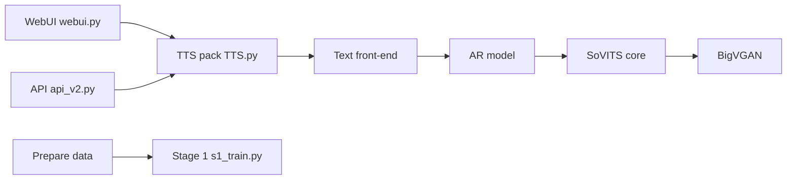

# RVC-Boss/GPT-SoVITS

> Text-to-speech and few-shot voice cloning WebUI, with dataset preparation tools.

## The problem
Cloning a voice usually takes hours of clean audio and a preparation chain (slicing, ASR, labeling) that you have to build yourself.

## What it actually does
Zero-shot TTS from a 5 s sample, fine-tuning with 1 min of data; Chinese, English, Japanese, Korean, Cantonese.
Pipeline: normalization/phonemization → AR text→semantic model → SoVITS decoder → BigVGAN vocoder.
Built-in tools: voice/accompaniment separation (UVR5), audio slicing, ASR (FunASR, Faster Whisper), labeling.
Entry points: `webui.py`, `inference_webui.py`, `api.py`/`api_v2.py`, ONNX/TorchScript export.

## How it is wired


## Trying it
```bash
conda create -n GPTSoVits python=3.10
conda activate GPTSoVits
bash install.sh --device <CU126|CU128|ROCM|CPU> --source <HF|HF-Mirror|ModelScope> [--download-uvr5]
python webui.py <language(optional)>
```

## Cost and gotchas
CUDA GPU recommended (training on Mac gives lower quality), FFmpeg required, pre-trained models to download separately. 895 open issues.

## What it is not
Not a clean Python library to import: it is an app with scripts. Documentation partly in Chinese. Cloning someone else's voice raises legal questions that the README does not address.

## Alternatives
- baicai-1145/GPT-SoVITS-CPUFast: version optimized for CPU inference.

## For you
Good ground for a local multilingual TTS proof of concept; not a building block to integrate as-is in production.
