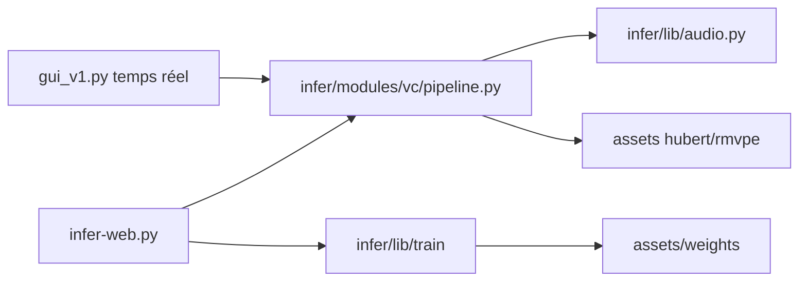

# RVC-Project/Retrieval-based-Voice-Conversion-WebUI

> Web interface for training and inference of voice conversion, for audio tinkerers.

## The problem
Cloning a voice timbre used to require a lot of data and a big GPU.

## What it actually does
Based on VITS: replaces the source voice's features with those of the training set (top-1 retrieval) to limit timbre leakage. Training with ~10 min of voice, RMVPE pitch extraction, model merging, vocal/accompaniment separation (pymss/MSST), real-time conversion (~170 ms claimed). Gradio WebUI on port 7865.

## How it is wired


## Trying it
```bash
python -m pip install -r requirments_cpu_py312.txt
hf download lj1995/VoiceConversionWebUI --revision main --include "hubert_base/*" --local-dir assets
python webui.py
```

## Cost and gotchas
NVIDIA GPU recommended (CUDA 11.8 or 12.8), otherwise CPU/DirectML. Python 3.12 required on this branch; several models to download.

## What it is not
Not a TTS: it transforms an existing voice. The legal framework of voice cloning is not addressed.

## Alternatives
None named as an alternative (VITS, HIFIGAN, ContentVec are building blocks).

## For you
Outside the data/MLOps core; worth a look only for an audio project.
