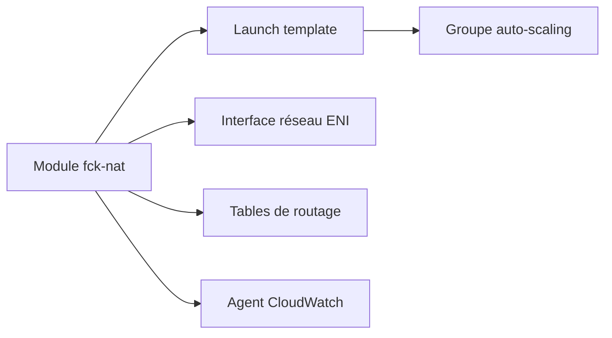

# RaJiska/terraform-aws-fck-nat

> Terraform module that deploys fck-nat NAT instances on AWS, cheaper than a NAT Gateway.

## The problem
AWS's managed NAT Gateway is expensive for small environments.

## What it actually does
Deploys a NAT instance (t4g.micro by default) with a high-availability mode using an auto-scaling group and a floating network interface. Options: fixed elastic IP, spot instances, CloudWatch metrics, NAT64, SSH access and route table updates.

## How it is wired


## Trying it
```hcl
module "fck-nat" {
  source = "git::https://github.com/RaJiska/terraform-aws-fck-nat.git"
  name = "my-fck-nat"
  vpc_id = "vpc-abc1234"
  subnet_id = "subnet-abc1234"
  update_route_tables = true
}
```

## Cost and gotchas
AWS account; Terraform ~> 1.9 and aws provider >= 6.0. EC2 instances and traffic are billed to you. Spot instances may be unavailable.

## What it is not
Not a managed NAT Gateway: you manage the instance and its updates. The `route_table_id` and `update_route_table` fields are deprecated.

## Alternatives
AWS managed NAT Gateway (implicit comparison through the CloudWatch metrics).

## For you
Worth watching: useful for cutting the network bill of test environments or development GPUs on AWS.
