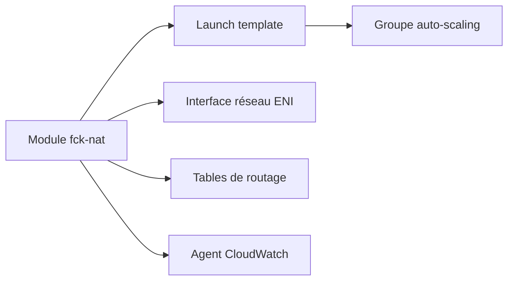

# RaJiska/terraform-aws-fck-nat

> Module Terraform qui déploie des instances NAT fck-nat sur AWS, moins chères qu'une NAT Gateway.

## Le problème
La NAT Gateway managée d'AWS coûte cher pour de petits environnements.

## Ce que ça fait vraiment
Déploie une instance NAT (t4g.micro par défaut) avec un mode haute disponibilité via groupe d'auto-scaling et interface réseau flottante. Options : IP élastique fixe, instances spot, métriques CloudWatch, NAT64, accès SSH et mise à jour des tables de routage.

## Comment c'est branché


## Essayer
```hcl
module "fck-nat" {
  source = "git::https://github.com/RaJiska/terraform-aws-fck-nat.git"
  name = "my-fck-nat"
  vpc_id = "vpc-abc1234"
  subnet_id = "subnet-abc1234"
  update_route_tables = true
}
```

## Coût et pièges
Compte AWS ; Terraform ~> 1.9 et fournisseur aws >= 6.0. Instances EC2 et trafic à ta charge. Les instances spot peuvent être indisponibles.

## Ce que ce n'est pas
Pas une NAT Gateway managée : tu gères l'instance et ses mises à jour. Les champs `route_table_id` et `update_route_table` sont dépréciés.

## Alternatives
NAT Gateway managée d'AWS (comparaison implicite via les métriques CloudWatch).

## Pour toi
À surveiller : utile pour réduire la facture réseau d'environnements de test ou de GPU de développement sur AWS.

