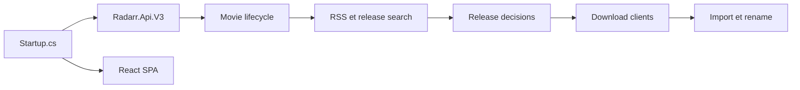

# Radarr/Radarr

> Self-hosted movie collection manager for Usenet and BitTorrent indexer users.

## The problem
Tracking movies, searching for releases, and importing and renaming them by hand is tedious.

## What it actually does
.NET backend: RSS sync and search on indexers, decision engine (quality profiles, custom formats, history, blocklist), sending to download clients (SABnzbd, NZBGet, qBittorrent…), import and renaming into the library, quality upgrades. `/api/v3` API, React interface, SignalR, SQLite or PostgreSQL.

## How it is wired

## Trying it
No command documented in the README.

## Cost and gotchas
Free, but you need indexers and download clients to configure. GPL-3.0 license. Only one version of a movie per instance.

## What it is not
Not a player or a media server. It provides no content: it orchestrates third-party services.

## Alternatives
No alternative named in the README.

## For you
Ignore: no link with data/AI; personal use for a media library.
