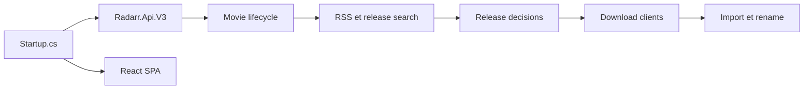

# Radarr/Radarr

> Gestionnaire de collection de films auto-hébergé pour utilisateurs d'indexeurs Usenet et BitTorrent.

## Le problème
Suivre des films, chercher les sorties et les importer et renommer à la main est fastidieux.

## Ce que ça fait vraiment
Backend .NET : synchronisation RSS et recherche sur indexeurs, moteur de décision (profils de qualité, formats personnalisés, historique, liste de blocage), envoi vers des clients de téléchargement (SABnzbd, NZBGet, qBittorrent…), import et renommage dans la bibliothèque, mises à jour de qualité. API `/api/v3`, interface React, SignalR, SQLite ou PostgreSQL.

## Comment c'est branché

## Essayer
Aucune commande documentée dans le README.

## Coût et pièges
Gratuit, mais il faut indexeurs et clients de téléchargement à configurer. Licence GPL-3.0. Une seule version d'un film par instance.

## Ce que ce n'est pas
Pas un lecteur ni un serveur multimédia. Il ne fournit pas de contenu : il orchestre des services tiers.

## Alternatives
Aucune alternative nommée dans le README.

## Pour toi
Ignorer : aucun lien avec data/IA ; usage personnel pour médiathèque.

