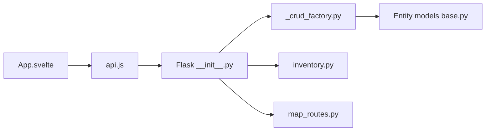

# RaidOwl/homelab-hub

> Self-hosted web application that inventories and maps the equipment and services of a homelab.

## The problem
Hardware, VMs, shares and applications of a homelab live in spreadsheets or in memory, with no view of how they relate.

## What it actually does
CRUD for hardware, VMs, apps, storage, shares and networks, cross-cutting search, JSON export/import, Cytoscape network map, hierarchical tree, Markdown documentation. Svelte frontend, Flask/SQLAlchemy backend with SQLite and Alembic migrations.

## How it is wired


## Trying it
```bash
docker run -d \
  --name homelab-hub \
  -p 8000:8000 \
  -v ./data:/data \
  --restart unless-stopped \
  raidowl/homelab-hub:latest
```

## Cost and gotchas
Free. JSON import erases all existing data: back up `./data/` first. No authentication is mentioned in the README.

## What it is not
Not a monitoring or auto-discovery tool: entry is manual. Last push on 2026-03-14, so less than a year ago but with no recent activity.

## Alternatives
No alternative named in the README.

## For you
Worth watching: useful for documenting a personal infrastructure, but with no documented auth; expose it on the internal network only.
