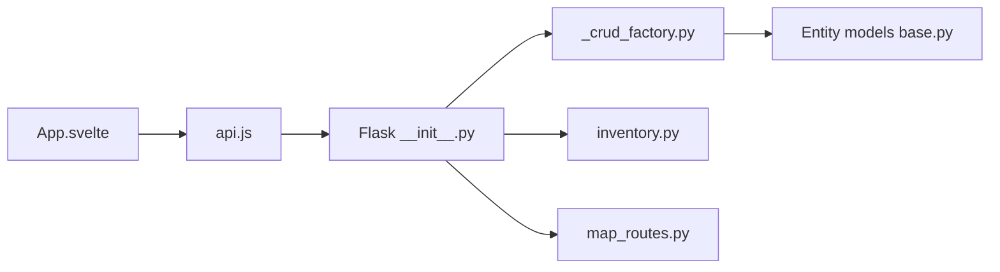

# RaidOwl/homelab-hub

> Application web auto-hébergée qui inventorie et cartographie les équipements et services d'un homelab.

## Le problème
Matériel, VM, partages et applications d'un homelab vivent dans des tableurs ou des mémoires, sans vue de leurs relations.

## Ce que ça fait vraiment
CRUD pour matériel, VM, apps, stockage, partages et réseaux, recherche transversale, export/import JSON, carte réseau Cytoscape, arbre hiérarchique, documentation Markdown. Frontend Svelte, backend Flask/SQLAlchemy avec SQLite et migrations Alembic.

## Comment c'est branché


## Essayer
```bash
docker run -d \
  --name homelab-hub \
  -p 8000:8000 \
  -v ./data:/data \
  --restart unless-stopped \
  raidowl/homelab-hub:latest
```

## Coût et pièges
Gratuit. L'import JSON efface toutes les données existantes : sauvegarder `./data/` avant. Aucune authentification n'est mentionnée dans le README.

## Ce que ce n'est pas
Pas un outil de supervision ni de découverte automatique : la saisie est manuelle. Dernier push du 2026-03-14, soit moins d'un an mais sans activité récente.

## Alternatives
Aucune alternative nommée dans le README.

## Pour toi
À surveiller : utile pour documenter une infra perso, mais sans auth documentée ; l'exposer sur réseau interne seulement.

