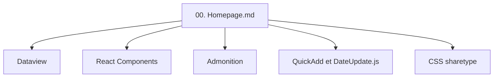

# Rainbell129/Obsidian-Homepage

> A homepage template for an Obsidian vault, with navigation, project tracking and daily notes.

## The problem
An Obsidian vault quickly becomes hard to browse without an entry page that gathers daily notes, projects and shortcuts.

## What it actually does
A page 00. Homepage.md and two CSS files: a navigation card to the periodic notes, tabs (music of the month, birthday countdown), a view of the sections of the daily note, project tracking by progress and an activity history. It relies on the Dataview, Banners, React Components, Admonition and Activity History plugins. A sample library in Chinese and English is provided.

## How it is wired
Simplified diagram based on the sheet, no diagram provided.

## Trying it
No command: the README describes a manual installation (plugins, components folder, two CSS files, opening 00. Homepage.md).

## Cost and gotchas
Free, but installation is long (five plugins). The README warns that the Icon Folder plugin can break search and sync.

## What it is not
Not a one-click installable plugin: a template vault to adapt. The last push dates from August 2024, with no follow-up since.

## Alternatives
No alternative named in the README.

## For you
Ignore: a personal template with no update for over a year, unrelated to data or AI work.
