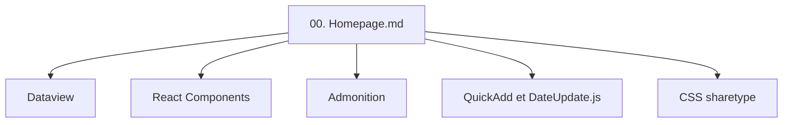

# Rainbell129/Obsidian-Homepage

> Un modèle de page d'accueil pour coffre Obsidian, avec navigation, suivi de projets et notes du jour.

## Le problème
Un coffre Obsidian devient vite difficile à parcourir sans page d'entrée qui rassemble notes du jour, projets et raccourcis.

## Ce que ça fait vraiment
Une page 00. Homepage.md et deux fichiers CSS : carte de navigation vers les notes périodiques, onglets (musique du mois, compte à rebours d'anniversaires), vue des sections de la note du jour, suivi de projets par progression et historique d'activité. Elle repose sur les extensions Dataview, Banners, React Components, Admonition et Activity History. Une bibliothèque d'exemple en chinois et en anglais est fournie.

## Comment c'est branché
Schéma simplifié d'après la fiche, sans diagramme fourni.

## Essayer
Aucune commande : le README décrit une installation manuelle (extensions, dossier components, deux fichiers CSS, ouverture de 00. Homepage.md).

## Coût et pièges
Gratuit, mais l'installation est longue (cinq extensions). Le README signale que l'extension Icon Folder peut casser la recherche et la synchronisation.

## Ce que ce n'est pas
Pas un plugin installable en un clic : un coffre modèle à adapter. Le dernier push date d'août 2024, sans suite depuis.

## Alternatives
Aucune alternative nommée dans le README.

## Pour toi
À ignorer : modèle personnel sans mise à jour depuis plus d'un an, sans lien avec le travail data ou IA.

