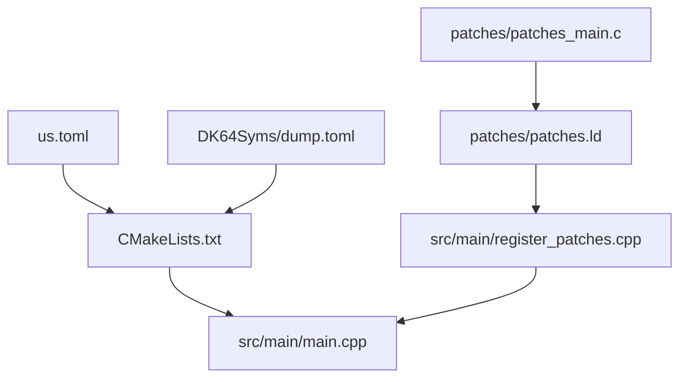

# Rainchus/Donkey-Kong-64-Recompiled

> Native port of Donkey Kong 64 by static recompilation of the ROM, for PC players.

## The problem
Playing Donkey Kong 64 on PC requires an emulator, with latency and limited settings.

## What it actually does
Uses N64: Recompiled to translate the game into a native program, with RT64 for rendering. Settings menus, controller options, instant loading. You must supply the US ROM; the repository does not contain one.

## How it is wired


## Trying it
```bash
# Aucune commande dans le README : prendre un binaire dans les Releases
# ou suivre BUILDING.md.
```

## Cost and gotchas
Requires a Direct3D 12 or Vulkan 1.2 GPU and a CPU with AVX. ROM to be supplied yourself. Known issues: Intel GPUs on Linux, capture overlays.

## What it is not
Not an emulator: only one ROM is accepted. Not based on a decompilation of the source code.

## Alternatives
None named in the README.

## For you
Ignore: a gaming project, unrelated to your data / AI / MLOps tools.
