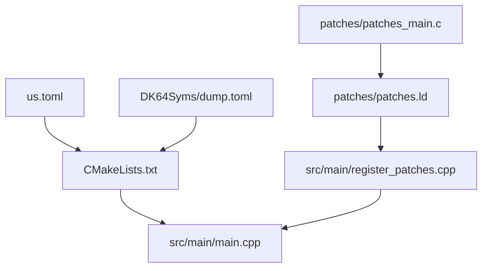

# Rainchus/Donkey-Kong-64-Recompiled

> Portage natif de Donkey Kong 64 par recompilation statique de la ROM, pour joueurs PC.

## Le problème
Jouer à Donkey Kong 64 sur PC demande un émulateur, avec latence et réglages limités.

## Ce que ça fait vraiment
Utilise N64: Recompiled pour traduire le jeu en programme natif, avec RT64 pour le rendu. Menus de réglages, options de manette, chargements instantanés. Il faut fournir la ROM américaine ; le dépôt n'en contient pas.

## Comment c'est branché


## Essayer
```bash
# Aucune commande dans le README : prendre un binaire dans les Releases
# ou suivre BUILDING.md.
```

## Coût et pièges
GPU Direct3D 12 ou Vulkan 1.2 et CPU avec AVX requis. ROM à fournir soi-même. Problèmes connus : GPU Intel sous Linux, surcouches de capture.

## Ce que ce n'est pas
Pas un émulateur : une seule ROM acceptée. Pas basé sur une décompilation du code source.

## Alternatives
Aucune nommée dans le README.

## Pour toi
À ignorer : projet de jeu, sans lien avec tes outils data / IA / MLOps.

