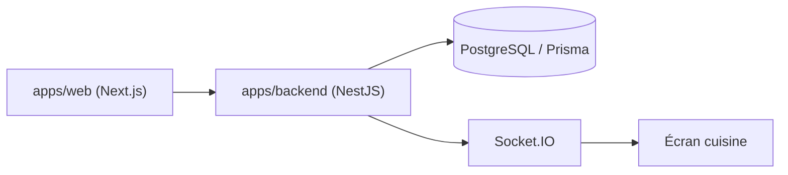

# Raktim94/nodedr-restaurant-pos

> Self-hosted, offline restaurant point of sale and management with UPI payment and kitchen, for restaurateurs.

## The problem
Restaurants pay for several subscriptions for point of sale, kitchen, inventory, payroll and accounting, and depend on their connection.

## What it actually does
A single local server runs Postgres, the NestJS API and the Next.js web app. Features: point of sale, tables and reservations, kitchen display (KDS), menu, inventory, loyalty, staff and payroll, accounting, reports, multi-site. The README states that not all modules are finished and indicates what remains to be done.

## How it is wired
Simplified diagram based on the sheet, no diagram provided.


## Trying it
```bash
git clone https://github.com/Raktim94/nodedr-restaurant-pos.git && cd nodedr-restaurant-pos && ./install.sh
docker compose up -d --build
```

## Cost and gotchas
Free, a local server or a VPS. AGPL-3.0 license. The payment-sharing feature and split billing are still in progress; some parts (printer, Windows client) are not tested on real hardware.

## What it is not
Not a point of sale certified everywhere: the Verifactu implementation is stated to be "not certified". Payment gateways other than Razorpay, Stripe and Cashfree are not done.

## Alternatives
The sibling project `nodedr-pos` (retail point of sale) is cited in the README.

## For you
Ignore: restaurant software unrelated to data, AI or MLOps, despite a side MCP server.
