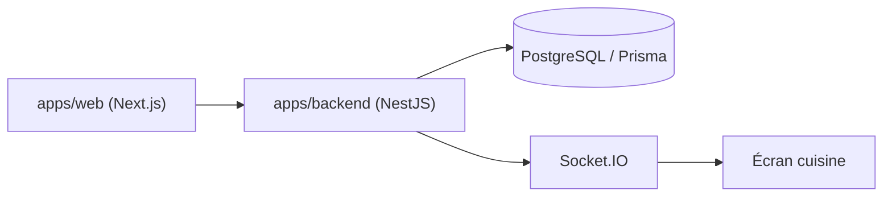

# Raktim94/nodedr-restaurant-pos

> Caisse et gestion de restaurant auto-hébergée, hors ligne, avec paiement UPI et cuisine, pour restaurateurs.

## Le problème
Les restaurants paient plusieurs abonnements pour caisse, cuisine, stocks, paie et comptabilité, et dépendent de leur connexion.

## Ce que ça fait vraiment
Un seul serveur local lance Postgres, l'API NestJS et le web Next.js. Fonctions : caisse, tables et réservations, écran cuisine (KDS), menu, stocks, fidélité, personnel et paie, comptabilité, rapports, multi-sites. Le README précise que tous les modules ne sont pas finis et indique ce qui reste à faire.

## Comment c'est branché
Schéma simplifié d'après la fiche, sans diagramme fourni.


## Essayer
```bash
git clone https://github.com/Raktim94/nodedr-restaurant-pos.git && cd nodedr-restaurant-pos && ./install.sh
docker compose up -d --build
```

## Coût et pièges
Gratuit, un serveur local ou un VPS. Licence AGPL-3.0. La fonction de partage des paiements et la facturation scindée sont encore en chantier ; certaines parties (imprimante, client Windows) ne sont pas testées sur du matériel réel.

## Ce que ce n'est pas
Ce n'est pas une caisse certifiée partout : l'implémentation Verifactu est dite « non certifiée ». Les passerelles de paiement autres que Razorpay, Stripe et Cashfree ne sont pas faites.

## Alternatives
Le projet frère `nodedr-pos` (caisse de commerce) est cité dans le README.

## Pour toi
À ignorer : logiciel de restauration sans lien avec data, IA ou MLOps, malgré un serveur MCP annexe.

