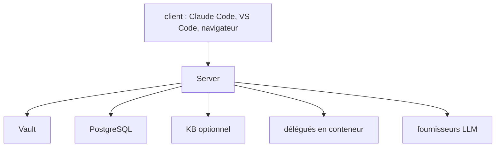

# RakuenSoftware/aimee

> Self-hosted runtime that keeps memory, code index and workflows for your AI tools, independently of the model.

## The problem
Changing model or AI client loses memory, sessions and decisions, and an agent's actions are hard to trace.

## What it actually does
A Server owns sessions, personal memory, code index, credentials (Vault) and delegates; an optional KB carries the shared corpus. It is exposed via MCP, ACP, and OpenAI- and Anthropic-compatible APIs. It handles durable workflows, delegates isolated in containers and a WORM audit trail.

## How it is wired
Simplified diagram based on the sheet, no diagram provided.

## Trying it
README quickstart (not detailed): generating the credentials then starting `compose.yaml`; variant `compose.server-managed.yaml`.

## Cost and gotchas
You operate a server, its backups and its updates. The managed composition gives the Server the host's Docker socket; volumes unencrypted by default. Provider keys are at your expense.

## What it is not
Not a model nor a client: it provides state and governance. It does not guarantee a cost reduction, and MCP only controls the calls going through it.

## Alternatives
No alternative named.

## For you
Watch: serious approach to agent memory and auditing, but heavy to operate; AGPL license to check depending on use.
