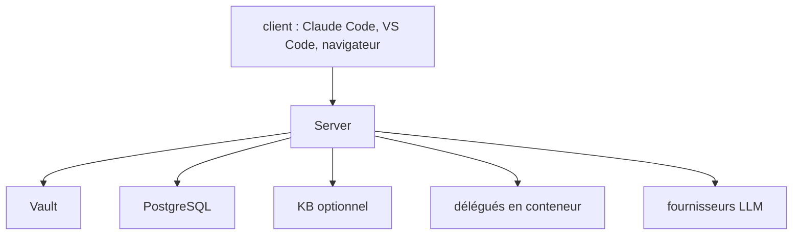

# RakuenSoftware/aimee

> Runtime auto-hébergé qui garde mémoire, index de code et workflows pour tes outils IA, indépendamment du modèle.

## Le problème
Changer de modèle ou de client IA fait perdre mémoire, sessions et décisions, et l'action d'un agent est difficile à tracer.

## Ce que ça fait vraiment
Un Server possède sessions, mémoire personnelle, index de code, identifiants (Vault) et délégués ; un KB optionnel porte le corpus partagé. Il s'expose via MCP, ACP, API compatibles OpenAI et Anthropic. Il gère des workflows durables, des délégués isolés en conteneurs et une trace d'audit WORM.

## Comment c'est branché
Schéma simplifié d'après la fiche, sans diagramme fourni.

## Essayer
Quickstart du README (non détaillé) : génération des identifiants puis démarrage de `compose.yaml` ; variante `compose.server-managed.yaml`.

## Coût et pièges
Tu opères un serveur, ses sauvegardes et ses mises à jour. La composition gérée donne au Server le socket Docker de l'hôte ; volumes non chiffrés par défaut. Clés des fournisseurs à ta charge.

## Ce que ce n'est pas
Pas un modèle ni un client : il fournit l'état et la gouvernance. Il ne garantit pas de baisse de coût, et MCP ne contrôle que les appels passant par lui.

## Alternatives
Aucune alternative nommée.

## Pour toi
À surveiller : approche sérieuse de la mémoire et de l'audit des agents, mais lourde à opérer ; licence AGPL à vérifier selon l'usage.

