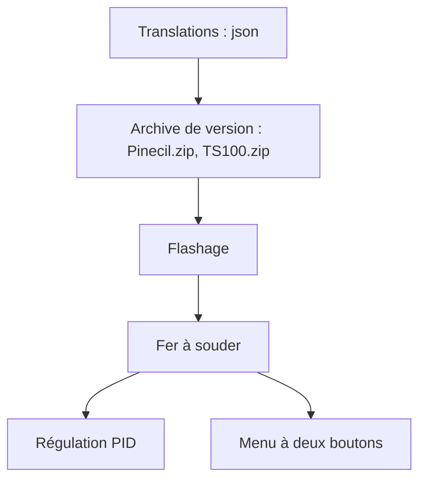

# Ralim/IronOS

> Open-source firmware for smart soldering irons (Pinecil, TS100, TS80 and others), for electronics hobbyists.

## The problem
The stock firmware of these irons is limited. IronOS adds PID regulation, automatic sleep and USB-PD or QC power supply handling.

## What it actually does
Firmware flashed onto the iron's board: PID temperature regulation, sleep with wake-on-motion, boost mode, a voltage cutoff for lithium batteries, PD and QC negotiation, 28 V in EPR on the Pinecil V2, a boot logo, screen rotation, 31 languages. Everything is set with two buttons and an on-screen menu.

## How it is wired
Simplified diagram based on the fiche, no diagram provided.

## Trying it
No command in the README: download the archive for your model, then follow the device's flashing guide (links without commands).

## Cost and gotchas
Free, but you need compatible hardware. The boot logo and animations are no longer in the repository. Bluetooth on the Pinecil V2 has been disabled by default since 2.23, for security reasons.

## What it is not
It is not computer software: it replaces a device's firmware. The USB port is not used to change settings while running.

## Alternatives
No alternative named in the README.

## For you
Ignore: hardware firmware unrelated to data, AI or MLOps.
