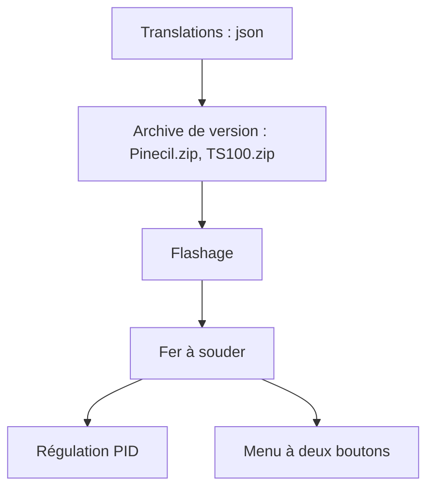

# Ralim/IronOS

> Firmware libre pour fers à souder intelligents (Pinecil, TS100, TS80 et d'autres), pour bricoleurs électroniciens.

## Le problème
Le firmware d'origine de ces fers est limité. IronOS ajoute régulation PID, veille automatique et gestion des alimentations USB-PD ou QC.

## Ce que ça fait vraiment
Firmware flashé sur la carte du fer : régulation PID de la température, veille avec réveil par mouvement, mode boost, seuil de tension pour batteries lithium, négociation PD et QC, 28 V en EPR sur Pinecil V2, logo de démarrage, rotation d'écran, 31 langues. Tout se règle par deux boutons et un menu à l'écran.

## Comment c'est branché
Schéma simplifié d'après la fiche, sans diagramme fourni.

## Essayer
Aucune commande dans le README : télécharger l'archive de son modèle, puis suivre le guide de flashage de l'appareil (liens sans commandes).

## Coût et pièges
Gratuit, mais il faut le matériel compatible. Le logo de démarrage et les animations ne sont plus dans le dépôt. Le Bluetooth du Pinecil V2 est désactivé par défaut depuis la 2.23, pour des raisons de sécurité.

## Ce que ce n'est pas
Ce n'est pas un logiciel pour ordinateur : il remplace le firmware d'un appareil. Le port USB ne sert pas à régler les paramètres en fonctionnement.

## Alternatives
Aucune alternative nommée dans le README.

## Pour toi
À ignorer : firmware matériel sans rapport avec la data, l'IA ou le MLOps.

