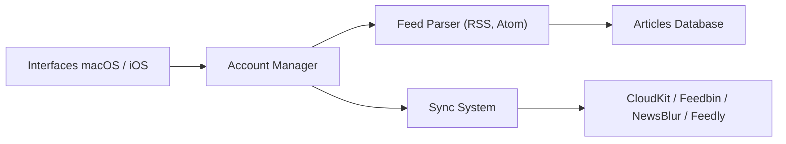

# Ranchero-Software/NetNewsWire

> Free RSS feed reader for macOS and iOS, whose provided README only describes building it.

## The problem
The provided README does not say; judging from the architecture, the app is used to follow RSS and Atom feeds locally or through services.

## What it actually does
The README read contains only contribution rules and the build. From the code: two interfaces (macOS and iOS), account management (CloudKit, Feedbin, NewsBlur, Feedly, Reader API), an RSS/Atom parser, an article database and a sync database, as well as extensions (widget, sharing).

## How it is wired


## Trying it
```bash
git clone https://github.com/Ranchero-Software/NetNewsWire.git
chmod +x setup.sh
./setup.sh
```

## Cost and gotchas
Building without a paid developer account is possible, but with features turned off: iCloud, Feedly and reader mode are disabled for lack of shared API keys. The README asks you to ask first before any PR.

## What it is not
Not a cross-platform project: Apple only. README truncated here: introduction and download are missing.

## Alternatives
No alternative named in the README.

## For you
Ignore: an RSS reader for Apple, unrelated to data/AI work; the sheet is thin anyway for lack of a complete README.
