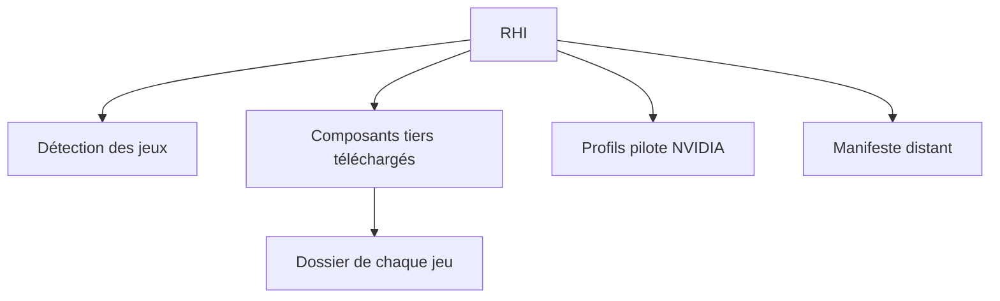

# RankFTW/RHI

> Windows application that installs and updates the HDR, ReShade and DLSS mods for your PC games.

## The problem
Setting up HDR, ReShade, DLSS and the NVIDIA driver game by game takes a lot of manual work and separate tools.

## What it actually does
Detects games from eight stores, then installs, updates and removes ReShade, RenoDX, Luma, OptiScaler, the DLSS/Streamline DLLs and frame limiters. Writes NVIDIA driver settings directly. Three interface layouts, controller supported. Third-party components are downloaded from their own sources.

## How it is wired
Simplified diagram based on the sheet, no diagram provided.

## Trying it
No command: download the latest version from the releases. A free GitHub token is recommended (limit of 60 requests per hour otherwise).

## Cost and gotchas
Free. Requires Windows 10/11, .NET 8 and the Windows App Runtime. Administrator mode is needed for some settings. Online anti-cheat risk: uninstall before playing multiplayer.

## What it is not
Not a work tool: it is about video games. Not cross-platform: Windows only. The DLSS and driver features require an NVIDIA card.

## Alternatives
No alternative named in the README (it replaces the official ReShade installer).

## For you
Ignore: a game-modding tool for Windows, unrelated to data / AI / MLOps work.
