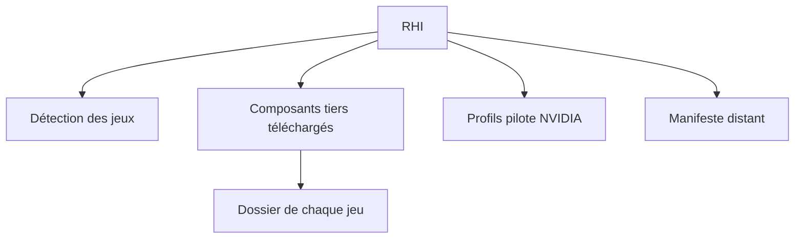

# RankFTW/RHI

> Application Windows qui installe et met à jour les mods HDR, ReShade et DLSS de tes jeux PC.

## Le problème
Régler HDR, ReShade, DLSS et pilote NVIDIA jeu par jeu demande beaucoup de manipulations manuelles et d'outils séparés.

## Ce que ça fait vraiment
Détecte les jeux de huit boutiques, puis installe, met à jour et retire ReShade, RenoDX, Luma, OptiScaler, les DLL DLSS/Streamline et des limiteurs d'images. Écrit directement des paramètres du pilote NVIDIA. Trois dispositions d'interface, manette prise en charge. Les composants tiers sont téléchargés depuis leurs sources.

## Comment c'est branché
Schéma simplifié d'après la fiche, sans diagramme fourni.

## Essayer
Aucune commande : télécharger la dernière version depuis les releases. Un jeton GitHub gratuit est recommandé (limite de 60 requêtes par heure sinon).

## Coût et pièges
Gratuit. Windows 10/11, .NET 8 et Windows App Runtime requis. Le mode administrateur est nécessaire pour certains réglages. Risque d'anti-triche en ligne : à désinstaller avant le multijoueur.

## Ce que ce n'est pas
Pas un outil de travail : il concerne le jeu vidéo. Pas multiplateforme : Windows seulement. Les fonctions DLSS et pilote exigent une carte NVIDIA.

## Alternatives
Aucune alternative nommée dans le README (il remplace l'installateur ReShade officiel).

## Pour toi
À ignorer : outil de modding de jeux sous Windows, sans lien avec un travail data / IA / MLOps.

