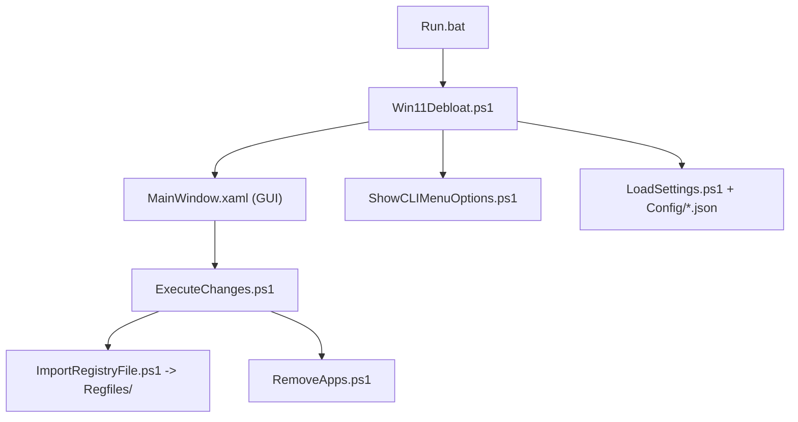

# Raphire/Win11Debloat

> PowerShell script that cleans up Windows 11 (apps, telemetry, AI, interface) for both users and administrators.

## The problem
Windows 11 comes with pre-installed apps, telemetry, advertisements, and AI-powered features. Removing these manually, one by one, is a time-consuming process.

## What it actually does
He applies a selected set of modifications: uninstalling apps (detected via winget), importing `.reg` files to disable telemetry, suggestions, Copilot/Recall, and Explorer, taskbar, and Windows Update settings. He offers a WPF interface or a CLI menu, and each mode (normal, rollback, Sysprep) has its own set of `.reg` files. He can target another user.

## How it is wired


## Trying it
```bash
# PowerShell (Windows)
& ([scriptblock]::Create((irm "https://debloat.raphi.re/")))

# Méthode avancée, après extraction du ZIP
Set-ExecutionPolicy Bypass -Scope Process -Force
.\Win11Debloat.ps1
```

## Cost and gotchas
Free, administrator rights required (UAC). The quick method executes a script downloaded remotely: please read it before running. The README states "use at your own risk".

## What it is not
This is not a tool for Linux or macOS, nor is it a security tool. The changes are announced as being reversible, but some affect the system through the registry.

## Alternatives
No alternative is specified in the README.

## For you
Useful if you are setting up Windows environments, but without a direct connection to data or MLOps: keep it bookmarked, but don't adopt it.
