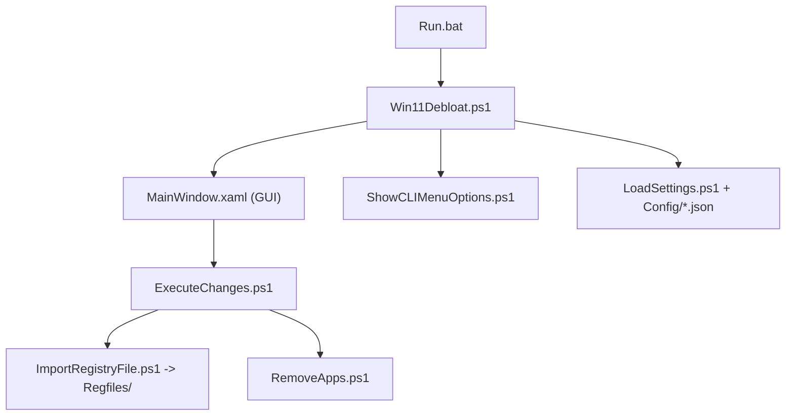

# Raphire/Win11Debloat

> Script PowerShell qui nettoie Windows 11 (apps, télémétrie, IA, interface) pour utilisateurs et administrateurs.

## Le problème
Windows 11 arrive avec des apps préinstallées, de la télémétrie, des publicités et des fonctions IA. Les retirer à la main, réglage par réglage, est long.

## Ce que ça fait vraiment
Il applique un ensemble choisi de modifications : suppression d'apps (détection via winget), import de fichiers `.reg` pour désactiver télémétrie, suggestions, Copilot/Recall, et réglages d'Explorer, de la barre des tâches et de Windows Update. Il propose une interface WPF ou un menu CLI, et chaque mode (normal, annulation, Sysprep) a son jeu de `.reg`. Il peut cibler un autre utilisateur.

## Comment c'est branché


## Essayer
```bash
# PowerShell (Windows)
& ([scriptblock]::Create((irm "https://debloat.raphi.re/")))

# Méthode avancée, après extraction du ZIP
Set-ExecutionPolicy Bypass -Scope Process -Force
.\Win11Debloat.ps1
```

## Coût et pièges
Gratuit, droits administrateur requis (UAC). La méthode rapide exécute un script téléchargé à distance : à lire avant d'exécuter. Le README dit « use at your own risk ».

## Ce que ce n'est pas
Pas un outil pour Linux ou macOS, ni un outil de sécurité. Les changements sont annoncés comme réversibles, mais certains passent par le registre et touchent le système.

## Alternatives
Aucune alternative nommée dans le README.

## Pour toi
Utile si tu prépares des postes Windows, mais sans lien direct avec la data ou le MLOps : à garder en signet, sans l'adopter.

