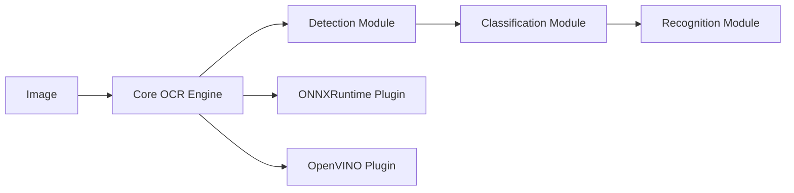

# RapidAI/RapidOCR

> Offline multi-engine OCR, based on PaddleOCR models converted to ONNX.

## The problem
PaddleOCR is heavy to deploy; you need a lightweight, offline, cross-platform OCR.

## What it actually does
It converts PaddleOCR models to ONNX and runs them through onnxruntime, OpenVINO, Paddle, PyTorch, TensorRT or MNN.
The pipeline goes from detection to classification, then recognition and post-processing.
Chinese and English by default, other languages via the model list.
This repository only contains the Python part; other languages have their own repositories.

## How it is wired


## Trying it
```bash
pip install rapidocr onnxruntime
make build-onnxruntime-cpu
make test-onnxruntime-cpu
```

## Cost and gotchas
Free, a CPU is enough. The full documentation only exists in Chinese.

## What it is not
Not a training tool: fine-tuning is done in PaddleOCR, then you redeploy here.

## Alternatives
- PaddleOCR: to fine-tune the models on your own data.

## For you
To adopt as a lightweight OCR building block in a document pipeline: Docling and Langchain already use it, and it runs on CPU.
