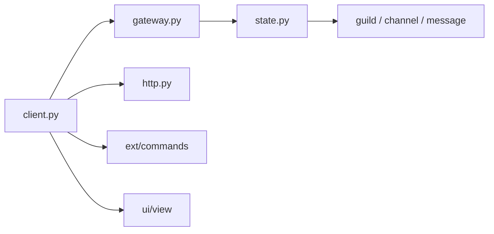

# Rapptz/discord.py

> Asynchronous Python library for writing Discord bots and clients.

## The problem
Talking to the Discord API (REST, Gateway WebSocket, voice) requires handling rate limits, reconnections and state caching.

## What it actually does
An `async`/`await` API that handles rate limiting, the client lifecycle, the gateway (with sharding), cached state, prefix commands (`ext.commands`), application commands, interactions and UI components (views, buttons, menus, modals), and optional voice (PyNaCl).

## How it is wired


## Trying it
```bash
python3 -m pip install -U discord.py
python3 -m pip install -U "discord.py[voice]"
```
```py
client = MyClient(intents=intents)
client.run('token')
```

## Cost and gotchas
Python 3.8+, a bot token to create. Depends entirely on the Discord platform. Voice on Linux: `libffi-dev` and `python-dev` must be installed.

## What it is not
It is not a hosted bot platform. The `message_content` intent must be enabled to read messages.

## Alternatives
No alternative named in the README.

## For you
Worth watching: useful for an alert or notification bot tied to an ML pipeline in Discord; otherwise off topic.
