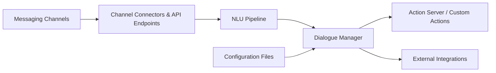

# RasaHQ/rasa

> Open-source framework for conversational assistants (NLU + dialogue), now in maintenance.

## The problem
Building a multi-channel contextual chatbot requires intent understanding, dialogue state management and connectors to each messaging platform.

## What it actually does
An NLU pipeline (tokenizers, featurizers, classifiers) that extracts intents and entities.
A policy-based dialogue manager that tracks state and triggers actions, including a custom action server.
Connectors for Messenger, Slack, Telegram, Twilio, Mattermost and others; event brokers (Kafka, SQL).
The README promotes Hello Rasa and CALM, the next LLM-based offering.

## How it is wired


## Trying it
```bash
make install
make prepare-tests-ubuntu
make test
```

## Cost and gotchas
Free, installation via Poetry. The README's commands are development ones, not a user installation.

## What it is not
No longer an active project: "maintenance mode". Hello Rasa is not this repo, it is a hosted playground that serves as a gateway to the commercial platform.

## Alternatives
- Hello Rasa / CALM: the path recommended by the vendor, LLM-oriented.

## For you
Ignore for a new project: the intent-based approach is outdated by LLMs and the vendor itself has moved elsewhere.
