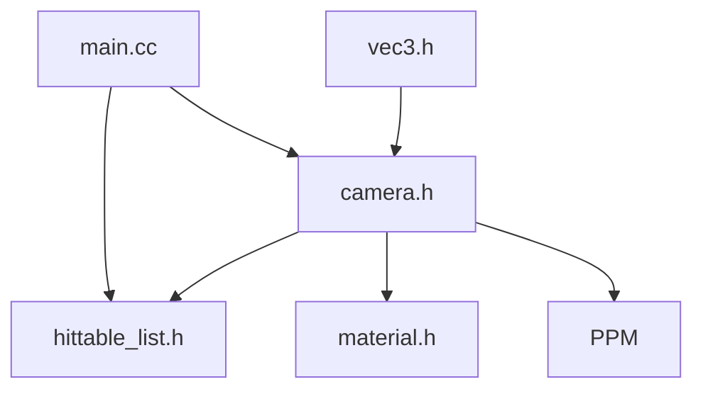

# RayTracing/raytracing.github.io

> Three free books for writing a ray tracer in C++, with the reference code.

## The problem
Understanding ray-traced rendering by implementing it yourself, without a paid course.

## What it actually does
The repository contains the three books in HTML and the final sources of each volume. Each program assembles a scene, configures a camera, traces the rays and writes a PPM image to standard output. The volumes add textures, BVH, participating media, then importance sampling.

## How it is wired


## Trying it
```bash
cmake -B build
cmake --build build
cmake --build build --target inOneWeekend
build\Release\inOneWeekend > image.ppm
```

## Cost and gotchas
Free. CMake and a C++ compiler are required; Release builds are faster. A PPM viewer is needed.

## What it is not
Not a ready-to-use rendering engine nor optimized C++: the code is there to compare with your own.

## Alternatives
No alternative named in the README (a list of implementations in other languages exists on the wiki).

## For you
Worth watching only if you want 3D rendering or graphics basics; no direct link to data, AI or MLOps.
