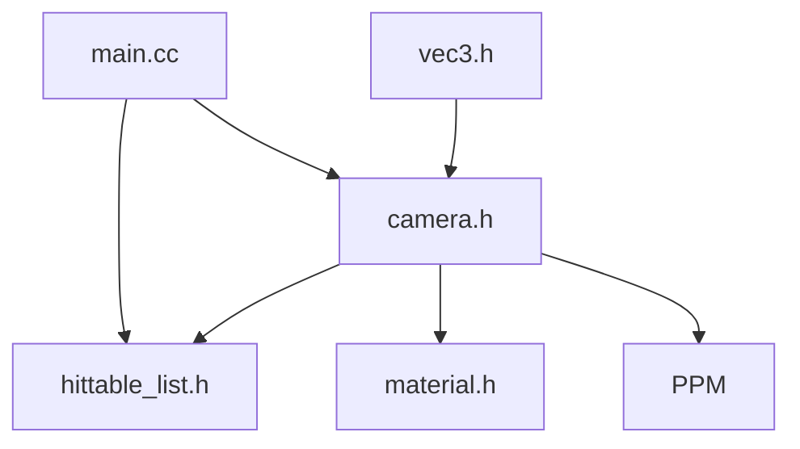

# RayTracing/raytracing.github.io

> Trois livres gratuits pour écrire un lanceur de rayons en C++, avec le code de référence.

## Le problème
Comprendre le rendu par lancer de rayons en l'implémentant soi-même, sans cours payant.

## Ce que ça fait vraiment
Le dépôt contient les trois livres en HTML et les sources finales de chaque volume. Chaque programme assemble une scène, configure une caméra, trace les rayons et écrit une image PPM sur la sortie standard. Les volumes ajoutent textures, BVH, milieux participatifs, puis échantillonnage par importance.

## Comment c'est branché


## Essayer
```bash
cmake -B build
cmake --build build
cmake --build build --target inOneWeekend
build\Release\inOneWeekend > image.ppm
```

## Coût et pièges
Gratuit. Il faut CMake et un compilateur C++ ; les builds Release sont plus rapides. Un visualiseur PPM est nécessaire.

## Ce que ce n'est pas
Pas un moteur de rendu prêt à l'emploi ni du C++ optimisé : le code sert à comparer avec le sien.

## Alternatives
Aucune alternative nommée dans le README (une liste d'implémentations dans d'autres langages existe sur le wiki).

## Pour toi
À surveiller seulement si tu veux des bases de rendu 3D ou de graphisme ; sans rapport direct avec data, IA ou MLOps.

