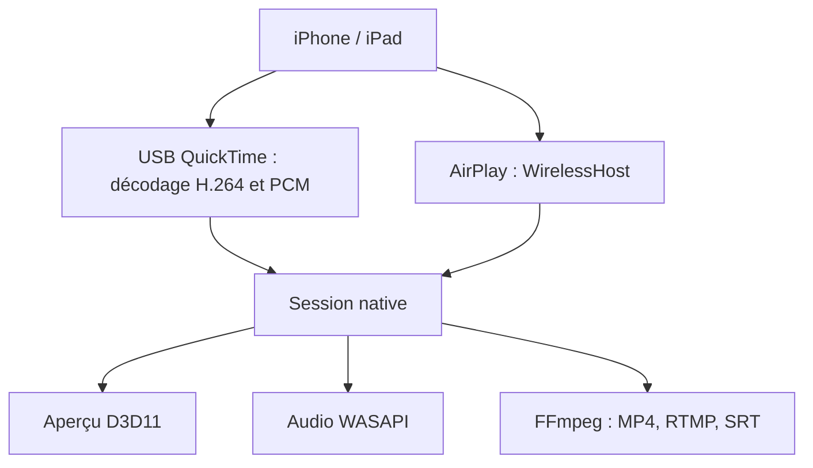

# RayrenSX/iPhoneMirror

> Captures an iPhone's screen and sound on Windows, over USB or AirPlay, with low latency.

## The problem
Displaying an iPhone on a Windows PC, for OBS or a demo, often takes two separate tools, with no multi-device handling.

## What it actually does
A Windows 10/11 x64 application (WPF, C++ core): USB stream through Apple's private protocol (QuickTime) and AirPlay on the local network, local H.264 decoding and D3D11 rendering. Each device gets its own window, usable in OBS; screenshots, recording and streaming via FFmpeg, virtual camera and WASAPI audio. Reverse control through BLE HID. A separate driver manager installs the USB driver.

## How it is wired


## Trying it
```bash
git clone https://github.com/RayrenSX/iPhoneMirror.git
cd iPhoneMirror
./build.ps1 -Configuration Release
```

## Cost and gotchas
Free. You need Apple Devices or iTunes for USB, a libusb0 driver installed by the dedicated tool, and an open firewall for AirPlay. No commercial signature (SmartScreen warning); Windows ARM64 is not supported.

## What it is not
Not a stable product: the Apple protocol is private and may break with an iOS update. The iUsbBridge component is under a non-commercial license, and the README flags code taken from a repository with an unclear license.

## Alternatives
No alternative cited in the README.

## For you
Ignore: a Windows screen-mirroring utility unrelated to your field, with mixed licenses (GPL, non-commercial, uncertain origin) to avoid in a company.
