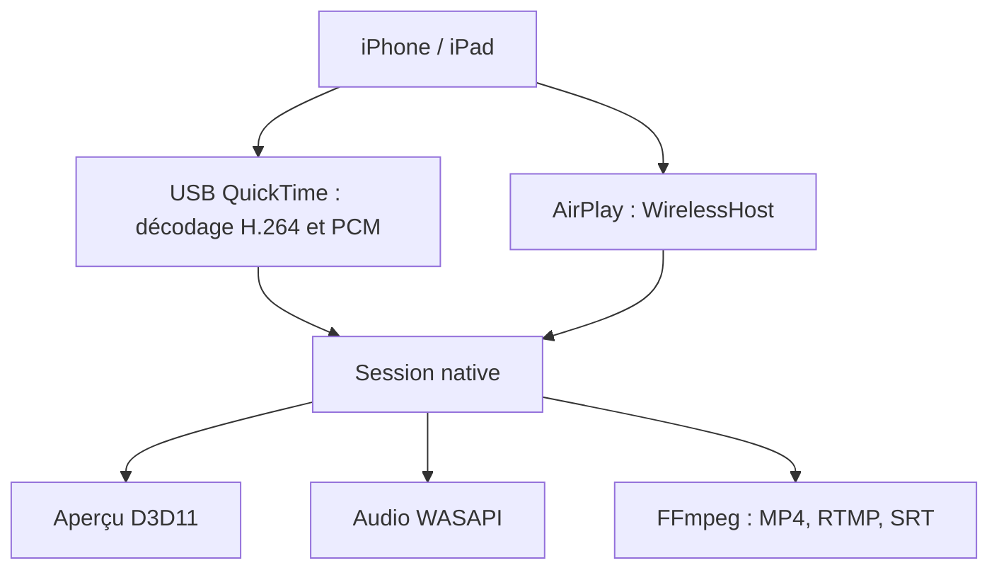

# RayrenSX/iPhoneMirror

> Capture de l'écran et du son d'un iPhone sur Windows, par USB ou AirPlay, à faible latence.

## Le problème
Afficher un iPhone sur un PC Windows, pour OBS ou une démo, passe souvent par deux outils distincts, sans gestion de plusieurs appareils.

## Ce que ça fait vraiment
Application Windows 10/11 x64 (WPF, cœur C++) : flux USB via le protocole privé Apple (QuickTime) et AirPlay sur le réseau local, décodage H.264 en local et rendu D3D11. Chaque appareil a sa fenêtre, utilisable dans OBS ; captures, enregistrement et streaming via FFmpeg, caméra virtuelle et audio WASAPI. Contrôle inverse par BLE HID. Un gestionnaire de pilotes séparé installe le pilote USB.

## Comment c'est branché


## Essayer
```bash
git clone https://github.com/RayrenSX/iPhoneMirror.git
cd iPhoneMirror
./build.ps1 -Configuration Release
```

## Coût et pièges
Gratuit. Il faut Apple Devices ou iTunes pour l'USB, un pilote libusb0 installé par l'outil dédié, et un pare-feu ouvert pour AirPlay. Pas de signature commerciale (alerte SmartScreen) ; Windows ARM64 n'est pas pris en charge.

## Ce que ce n'est pas
Pas un produit stable : le protocole Apple est privé et peut casser à une mise à jour d'iOS. Le composant iUsbBridge est sous licence non commerciale, et le README signale du code repris d'un dépôt sans licence claire.

## Alternatives
Aucune alternative citée dans le README.

## Pour toi
À ignorer : utilitaire Windows de duplication d'écran, sans lien avec ton métier, avec des licences mélangées (GPL, non commerciale, origine incertaine) à éviter en entreprise.

