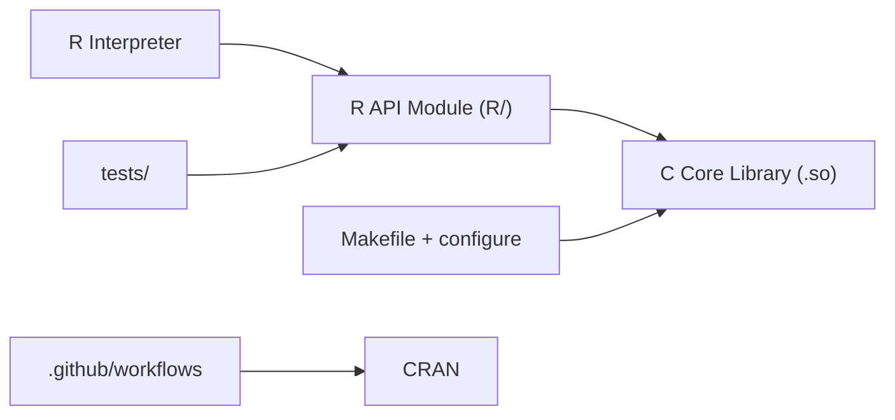

# Rdatatable/data.table

> Fast, memory-efficient extension of data.frame in R, for analysts and data scientists.

## The problem
R's base data.frames become slow and memory-hungry on large volumes, with verbose syntax.

## What it actually does
`DT[i, j, by]` syntax to filter, aggregate and group, adding or updating columns by reference, rich joins (non-equi, interval, rolling), fast `fread` / `fwrite`, `melt` / `dcast`. Parallelized C core (OpenMP). No dependency beyond base R, compatible with R 3.5.0.

## How it is wired


## Trying it
```r
install.packages("data.table")
library(data.table)
DT = as.data.table(iris)
DT[Petal.Width > 1.0, mean(Petal.Length), by = Species]
```

## Cost and gotchas
Free. Governance under an in-house agreement, NumFOCUS fiscal sponsorship. 1,002 open issues. MPL-2.0 license: file-level copyleft.

## What it is not
Not a database nor Python. The benchmark figures (two billion rows) come from the project, not verified here.

## Alternatives
No alternative named in the README (implicit comparison with data.frame and IRanges).

## For you
Watch: excellent if you work with tabular data in R; if your stack is Python, there is nothing to adopt.
