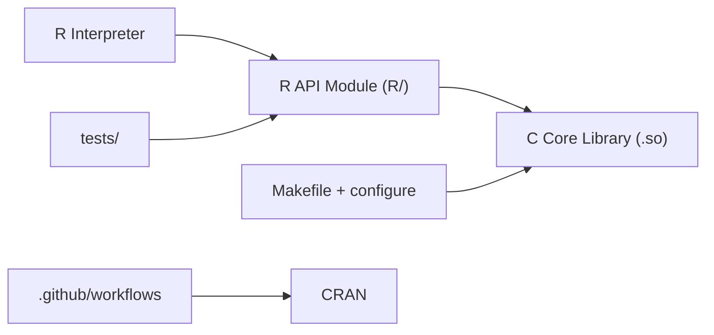

# Rdatatable/data.table

> Extension de data.frame en R, rapide et économe en mémoire, pour analystes et data scientists.

## Le problème
Les data.frame de base de R deviennent lents et gourmands sur de gros volumes, avec une syntaxe verbeuse.

## Ce que ça fait vraiment
Syntaxe `DT[i, j, by]` pour filtrer, agréger et regrouper, ajout ou mise à jour de colonnes par référence, jointures riches (non-équi, par intervalle, roulantes), `fread` / `fwrite` rapides, `melt` / `dcast`. Noyau en C parallélisé (OpenMP). Aucune dépendance hors R de base, compatible R 3.5.0.

## Comment c'est branché


## Essayer
```r
install.packages("data.table")
library(data.table)
DT = as.data.table(iris)
DT[Petal.Width > 1.0, mean(Petal.Length), by = Species]
```

## Coût et pièges
Gratuit. Gouvernance sous accord maison, parrainage fiscal NumFOCUS. 1 002 issues ouvertes. Licence MPL-2.0 : copyleft au niveau des fichiers.

## Ce que ce n'est pas
Pas une base de données ni du Python. Les chiffres de benchmark (deux milliards de lignes) viennent du projet, non vérifiés ici.

## Alternatives
Aucune alternative nommée dans le README (comparaison implicite avec data.frame et IRanges).

## Pour toi
Surveiller : excellent si tu fais de la donnée tabulaire en R ; si ton stack est Python, il n'y a rien à adopter.

