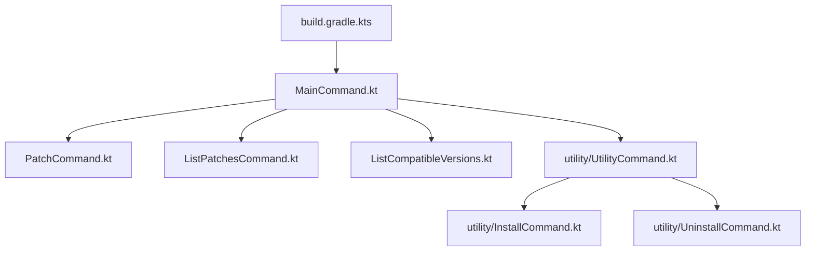

# ReVanced/revanced-cli

> Command-line application that applies ReVanced patches to Android applications.

## The problem
Modifying Android applications with a set of patches requires a tool that assembles, applies and installs the result.

## What it actually does
MainCommand.kt dispatches to the subcommands: patch (uses ReVanced Patcher), list of a bundle's patches, list of compatible versions, and install and uninstall utilities through ADB, the package manager or root mounting. The build goes through Gradle.

## How it is wired

## Trying it
No command in the README: it points to the usage documentation (docs/1_usage.md) and the download link.

## Cost and gotchas
Free, GPL-3.0. Works with ADB for installation. The README does not specify the required Java version, but the project is written in Kotlin and built with Gradle.

## What it is not
Not a set of patches: those come from separate bundles.

## Alternatives
No alternative named in the README.

## For you
Ignore: Android application customization unrelated to data, AI or MLOps.
