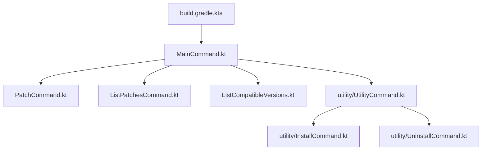

# ReVanced/revanced-cli

> Application en ligne de commande qui applique des patches ReVanced à des applications Android.

## Le problème
Modifier des applications Android avec un ensemble de patches demande un outil qui assemble, applique et installe le résultat.

## Ce que ça fait vraiment
MainCommand.kt répartit vers les sous-commandes : patch (utilise ReVanced Patcher), liste des patches d'un bundle, liste des versions compatibles et utilitaires d'installation et de désinstallation par ADB, par le gestionnaire de paquets ou en montage root. La construction passe par Gradle.

## Comment c'est branché

## Essayer
Aucune commande dans le README : il renvoie à la documentation d'usage (docs/1_usage.md) et au lien de téléchargement.

## Coût et pièges
Gratuit, GPL-3.0. Fonctionne avec ADB pour l'installation. Le README ne précise pas la version de Java requise, mais le projet est écrit en Kotlin et se construit avec Gradle.

## Ce que ce n'est pas
Ce n'est pas un jeu de patches : ceux-ci viennent de bundles séparés.

## Alternatives
Aucune alternative nommée dans le README.

## Pour toi
À ignorer : personnalisation d'applications Android sans lien avec la data, l'IA ou le MLOps.

