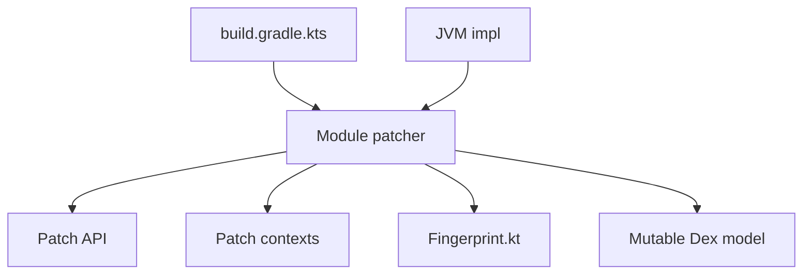

# ReVanced/revanced-patcher

> Kotlin library for modifying Android applications: Dalvik bytecode, resources and APK files.

## The problem
Modifying an already compiled Android application requires disassembling, editing and rebuilding bytecode and resources by hand.

## What it actually does
- Disassembles and reassembles Dalvik bytecode, decodes and rebuilds resources.
- Reads and writes arbitrary files in the APK.
- Modular patch API, with "fingerprints" to find targets despite version changes.
- Powers ReVanced Manager, ReVanced CLI and the patches of the ReVanced Patches repository.

## How it is wired


## Trying it
```kotlin
dependencies {
    implementation("app.revanced:revanced-patcher:{$version}")
}
```

## Cost and gotchas
Free, GPL-3.0. Real requirement: JVM and Gradle; the package repository must be added as described in the ReVanced docs.

## What it is not
Neither an application nor patches: only the engine. It modifies applications you did not write, which raises rights questions.

## Alternatives
No alternative named in the README.

## For you
Ignore: Android reverse engineering, unrelated to data or AI.
