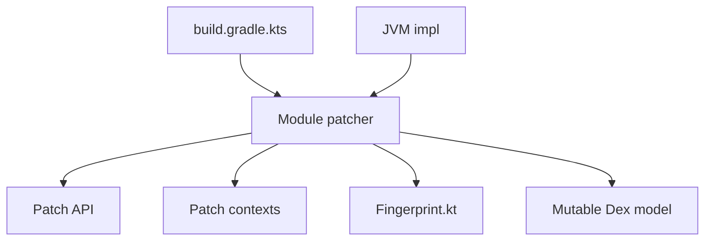

# ReVanced/revanced-patcher

> Bibliothèque Kotlin pour modifier des applications Android : bytecode Dalvik, ressources et fichiers de l'APK.

## Le problème
Modifier une application Android déjà compilée demande de désassembler, d'éditer et de reconstruire bytecode et ressources à la main.

## Ce que ça fait vraiment
- Désassemble et réassemble le bytecode Dalvik, décode et reconstruit les ressources.
- Lit et écrit des fichiers arbitraires dans l'APK.
- API de patchs modulaires, avec « empreintes » pour retrouver les cibles malgré les changements de version.
- Alimente ReVanced Manager, ReVanced CLI et les patchs du dépôt ReVanced Patches.

## Comment c'est branché


## Essayer
```kotlin
dependencies {
    implementation("app.revanced:revanced-patcher:{$version}")
}
```

## Coût et pièges
Gratuit, GPL-3.0. Besoin réel : JVM et Gradle ; le dépôt de paquets est à ajouter selon la doc ReVanced.

## Ce que ce n'est pas
Ni application ni patchs : seulement le moteur. Il modifie des applications que tu n'as pas écrites, ce qui pose des questions de droits.

## Alternatives
Aucune alternative nommée dans le README.

## Pour toi
À ignorer : ingénierie inverse Android, sans lien avec la donnée ni l'IA.

