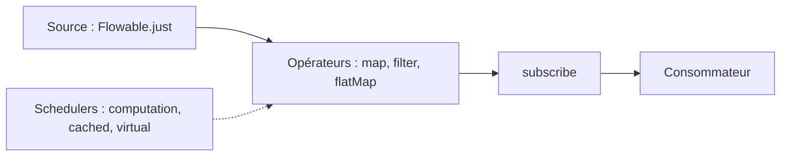

# ReactiveX/RxJava

> Java library for composing asynchronous programs from observable streams, for JVM developers.

## The problem
Hand-writing asynchronous programs (threads, synchronization, backpressure) produces fragile code that is hard to read.

## What it actually does
Provides stream types (Flowable, Observable, Single, Maybe, Completable) and chained operators (map, filter, flatMap) to describe a processing pipeline. Schedulers choose which thread it runs on. Flowable handles backpressure. The announced version 4 builds on Java 26 and virtual threads. The supplied README is truncated at the end.

## How it is wired

Simplified diagram based on the sheet, no diagram supplied.

## Trying it
```bash
# Dépendance Gradle citée dans le README
implementation "io.reactivex.rxjava4:rxjava:4.x.y"
```

## Cost and gotchas
Free. It needs a JVM (Java), which is not in the prerequisites list. Version 4.0.0 is announced for 2026-11-30: the API changes (io.reactivex.rxjava4, Schedulers.io() deprecated), and support for 3.x is to be reduced.

## What it is not
Not a distributed processing engine: streams live within a single process. Not easy to pick up: the difference between assembly, subscription and execution is surprising.

## Alternatives
No alternative named in the README.

## For you
Ignore on the data / AI side: it is a Java reactive programming tool, useful only if you maintain an asynchronous JVM service.
