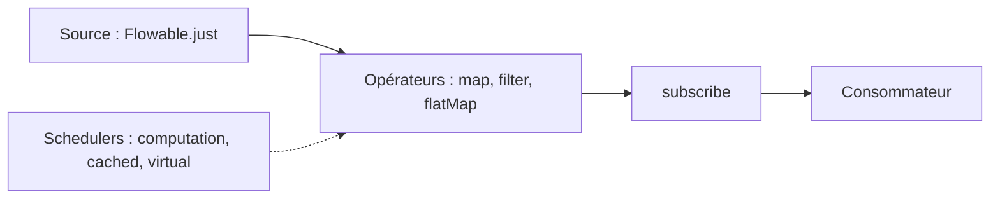

# ReactiveX/RxJava

> Bibliothèque Java pour composer des programmes asynchrones à partir de flux observables, pour développeurs JVM.

## Le problème
Écrire à la main des programmes asynchrones (threads, synchronisation, contre-pression) donne un code fragile et difficile à relire.

## Ce que ça fait vraiment
Fournit des types de flux (Flowable, Observable, Single, Maybe, Completable) et des opérateurs chaînés (map, filter, flatMap) pour décrire un traitement. Des Schedulers choisissent sur quel fil il s'exécute. Flowable gère la contre-pression. La version 4 annoncée s'appuie sur Java 26 et les threads virtuels. Le README fourni est tronqué en fin de document.

## Comment c'est branché

Schéma simplifié d'après la fiche, sans diagramme fourni.

## Essayer
```bash
# Dépendance Gradle citée dans le README
implementation "io.reactivex.rxjava4:rxjava:4.x.y"
```

## Coût et pièges
Gratuit. Il faut une JVM (Java), non prévue dans la liste des prérequis. La version 4.0.0 est annoncée pour le 2026-11-30 : l'API change (io.reactivex.rxjava4, Schedulers.io() déprécié), et le support de la 3.x doit être réduit.

## Ce que ce n'est pas
Pas un moteur de traitement distribué : les flux vivent dans un seul processus. Pas simple d'accès : la différence entre assemblage, abonnement et exécution surprend.

## Alternatives
Aucune alternative nommée dans le README.

## Pour toi
À ignorer côté data / IA : c'est un outil de programmation réactive Java, utile seulement si tu maintiens un service JVM asynchrone.

