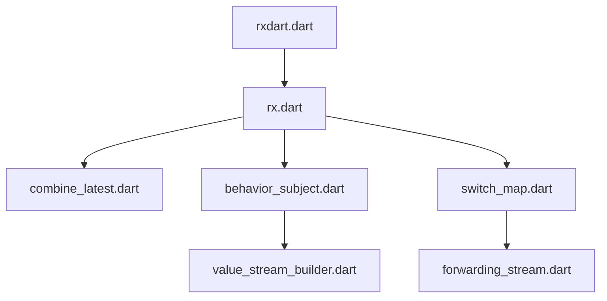

# ReactiveX/rxdart

> ReactiveX extension of Dart Streams, for asynchronous programming in Dart and Flutter.

## The problem
Native Dart Streams lack reactive operators such as switchMap, debounce or combineLatest.

## What it actually does
Adds factories, subjects (BehaviorSubject) and transformers on top of Dart Streams, via `forwarding_stream`. The `rxdart_flutter` package provides widgets bound to ValueStream. Very short README: the rest is not documented here.

## How it is wired

## Trying it
No command in the README; two pub.dev packages: `rxdart` and `rxdart_flutter`.

## Cost and gotchas
Free. Requires a Dart or Flutter project, not covered by the prerequisites list.

## What it is not
Not a Python library, nor for big-data-style stream processing: it serves Dart applications.

## Alternatives
No alternative cited in the README.

## For you
Ignore: reserved for Dart and Flutter developers, with no use in data, AI or MLOps work.
