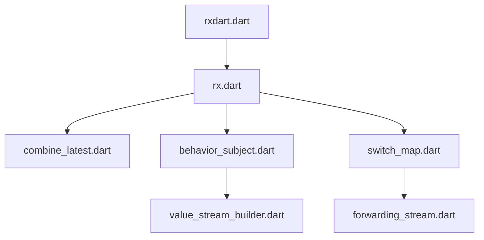

# ReactiveX/rxdart

> Extension ReactiveX des Streams Dart, pour la programmation asynchrone en Dart et Flutter.

## Le problème
Les Streams natifs de Dart manquent d'opérateurs réactifs comme switchMap, debounce ou combineLatest.

## Ce que ça fait vraiment
Ajoute fabriques, sujets (BehaviorSubject) et transformateurs au-dessus des Streams Dart, via `forwarding_stream`. Le paquet `rxdart_flutter` fournit des widgets liés aux ValueStream. README très court : le reste n'est pas documenté ici.

## Comment c'est branché

## Essayer
Aucune commande dans le README ; deux paquets pub.dev : `rxdart` et `rxdart_flutter`.

## Coût et pièges
Gratuit. Il faut un projet Dart ou Flutter, non couvert par la liste des prérequis.

## Ce que ce n'est pas
Pas une bibliothèque Python ni pour traitement de flux de données de type big data : elle sert aux applications Dart.

## Alternatives
Aucune alternative citée dans le README.

## Pour toi
Ignorer : réservé aux développeurs Dart et Flutter, sans usage dans un travail data, IA ou MLOps.

