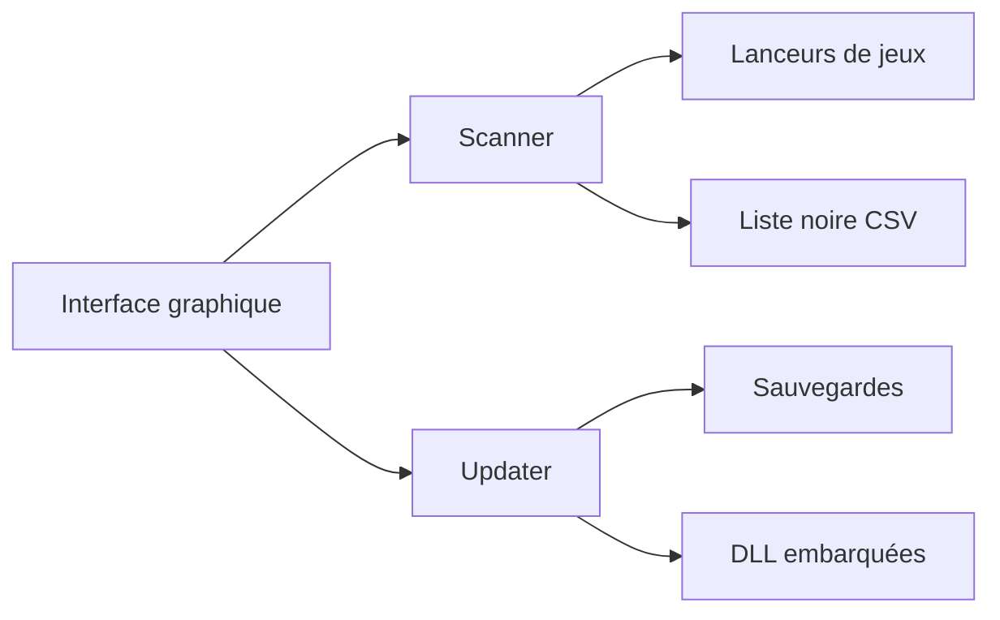

# Recol/DLSS-Updater

> Windows and Linux application that updates the DLSS, XeSS and FSR DLLs of installed games from one place.

## The problem
Each game ships its own version of the upscaling DLLs, often outdated; replacing them by hand is time-consuming.

## What it actually does
Detects Steam, Epic, GOG, Ubisoft, EA, Battle.net and Xbox games, replaces the DLLs with the bundled versions (with a restorable backup), applies DLSS presets through the NVIDIA driver profile on Windows, and generates Proton launch options on Linux. Community game blacklist, automatic update.

## How it is wired


## Trying it
```bash
winget install "DLSS Updater"
flatpak install --user DLSS_Updater-X.Y.Z.flatpak
flatpak run io.github.recol.dlss-updater
```

## Cost and gotchas
Backup before every change. Windows global settings are marked experimental; games with anti-cheat are not excluded globally, only case by case. The blacklist lives in another repository. The provided diagram (PyQt6, Python 3.12) differs from the README (Python 3.14, uv).

## What it is not
Not a general-purpose gaming tool: it modifies game files, which can cause compatibility problems or bans.

## Alternatives
No alternative named in the README.

## For you
Ignore: PC gamer utility, AGPL-3.0, unrelated to data or AI.
