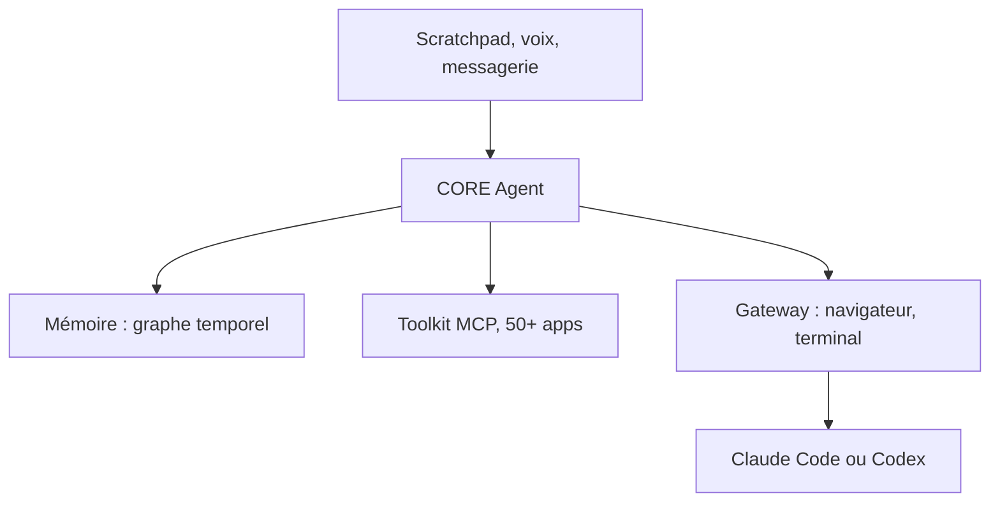

# RedPlanetHQ/core

> Self-hosted personal AI assistant, with memory and tasks, that delegates code to Claude Code or Codex.

## The problem
Assistants do not keep context across emails, tickets, meetings and repos, and only act when you open them.

## What it actually does
CORE indexes your tools into a temporal knowledge graph. You write a task in a daily notebook, it picks it up within three minutes, prepares a plan, which you approve. It then launches a Claude Code or Codex session, drives an isolated browser and joins you via WhatsApp, Slack or Telegram. More than 50 integrations go through MCP.

## How it is wired
Simplified diagram based on the sheet, no diagram provided.


## Trying it
```bash
npm install -g @redplanethq/corebrain && corebrain setup
corebrain login
corebrain gateway setup
```

## Cost and gotchas
Docker 20.10+, Compose 2.20+, 4 vCPU and 8 GB of RAM. A provider API key is requested at install, or the existing Claude/Codex subscription via a proxy. 212 open issues.

## What it is not
Not a simple chatbot: it is a full stack to host. The LoCoMo score of 88.24% is claimed by the author. The license is not identified by GitHub.

## Alternatives
- OpenClaw: compared in the README, fewer interfaces.
- Hermes Agent: persistent memory but fewer interfaces according to the README.

## For you
Keep an eye on it: temporal memory and delegation to coding agents are interesting, but the unclear license and heavy stack call for a trial before adoption.
