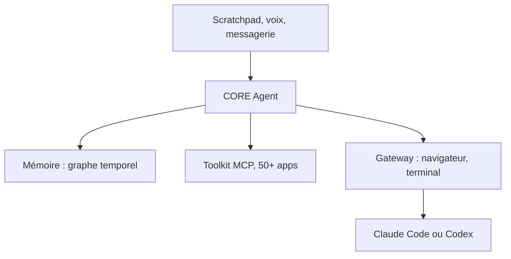

# RedPlanetHQ/core

> Assistant IA personnel auto-hébergé, avec mémoire et tâches, qui délègue le code à Claude Code ou Codex.

## Le problème
Les assistants ne gardent pas le contexte entre mails, tickets, réunions et dépôts, et n'agissent que quand on les ouvre.

## Ce que ça fait vraiment
CORE indexe tes outils dans un graphe de connaissances temporel. Tu écris une tâche dans un carnet quotidien, il la reprend sous trois minutes, prépare un plan, que tu approuves. Il lance alors une session Claude Code ou Codex, pilote un navigateur isolé et se joint via WhatsApp, Slack ou Telegram. Plus de 50 intégrations passent par MCP.

## Comment c'est branché
Schéma simplifié d'après la fiche, sans diagramme fourni.


## Essayer
```bash
npm install -g @redplanethq/corebrain && corebrain setup
corebrain login
corebrain gateway setup
```

## Coût et pièges
Docker 20.10+, Compose 2.20+, 4 vCPU et 8 Go de RAM. Une clé d'API de fournisseur est demandée à l'installation, ou l'abonnement Claude/Codex existant via un proxy. 212 issues ouvertes.

## Ce que ce n'est pas
Pas un simple chatbot : c'est une pile complète à héberger. Le score LoCoMo de 88,24 % est annoncé par l'auteur. La licence n'est pas identifiée par GitHub.

## Alternatives
- OpenClaw : comparé dans le README, interfaces moindres.
- Hermes Agent : mémoire persistante mais moins d'interfaces selon le README.

## Pour toi
À surveiller : la mémoire temporelle et la délégation aux agents de code sont intéressantes, mais licence floue et pile lourde demandent un essai avant adoption.

