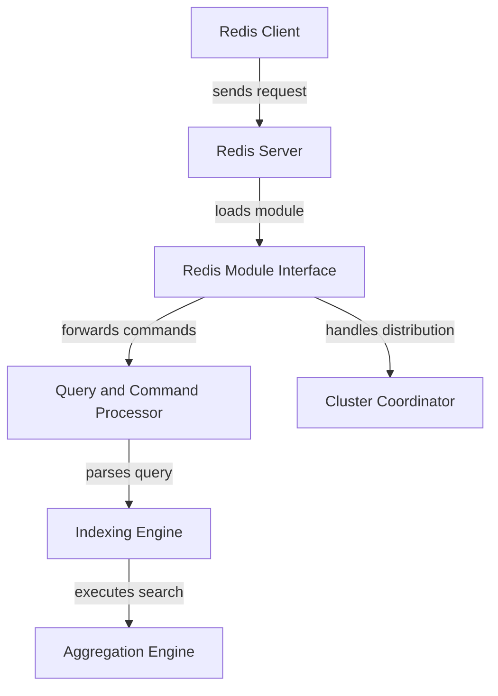

# RediSearch/RediSearch

> Redis module for secondary indexing and full-text search, now built into Redis 8.

## The problem
Redis alone cannot query its data by text, numeric filters or vector similarity.

## What it actually does
You declare indexes on Redis data, then query them with the RediSearch query language. Compressed inverted indexes, BM25 ranking, fuzzy, prefix or exact-phrase search, numeric and geographic filters, aggregations, vector search (KNN, filtered KNN, range). The code is in C with parts in Rust.

## How it is wired


## Trying it
```bash
# Aucune commande dans le README : voir le tutoriel et le démarrage rapide de la documentation Redis.
```

## Cost and gotchas
The catalog notes a license that is present but not identified by GitHub: to be checked. The repository requires contributors to accept the Redis Software Grant and CLA. 32-bit systems are not supported.

## What it is not
It is no longer a module to install separately: from Redis 8 it is built in and standalone versions are no longer published. It is not a dedicated vector database but an extension of Redis.

## Alternatives
The README points to the redis/redis repository, which now includes the module.

## For you
Worth watching: useful for RAG on Redis, but the standalone version is abandoned, so go through Redis 8 instead, and check the license.
