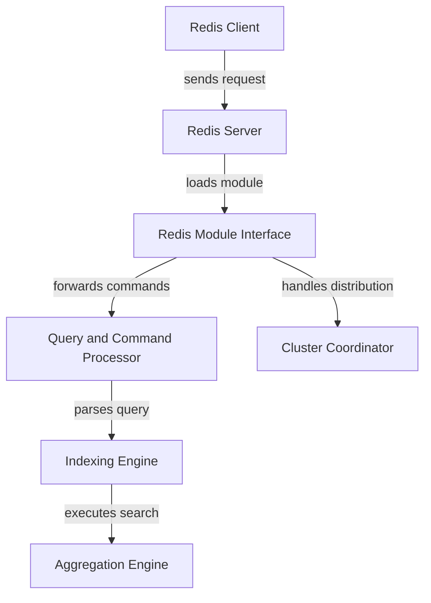

# RediSearch/RediSearch

> Module Redis d'indexation secondaire et de recherche plein texte, désormais intégré à Redis 8.

## Le problème
Redis seul ne sait pas interroger ses données par texte, filtres numériques ou similarité vectorielle.

## Ce que ça fait vraiment
On déclare des index sur les données Redis, puis on les interroge avec le langage de requête RediSearch. Index inversés compressés, classement BM25, recherche floue, par préfixe ou par phrase exacte, filtres numériques et géographiques, agrégations, recherche vectorielle (KNN, KNN filtré, plage). Le code est en C avec des parties en Rust.

## Comment c'est branché


## Essayer
```bash
# Aucune commande dans le README : voir le tutoriel et le démarrage rapide de la documentation Redis.
```

## Coût et pièges
Le catalogue relève une licence présente mais non identifiée par GitHub : à vérifier. Le dépôt impose le Redis Software Grant and CLA aux contributeurs. Les systèmes 32 bits ne sont pas pris en charge.

## Ce que ce n'est pas
Ce n'est plus un module à installer à part : à partir de Redis 8 il est intégré et les versions autonomes ne sont plus publiées. Ce n'est pas une base vectorielle dédiée mais une extension de Redis.

## Alternatives
Le README renvoie au dépôt redis/redis, qui intègre désormais le module.

## Pour toi
À surveiller : utile pour du RAG sur Redis, mais le standalone est abandonné, donc passe plutôt par Redis 8, et vérifie la licence.

