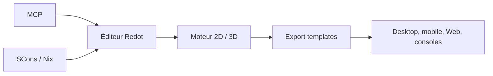

# Redot-Engine/redot-engine

> A cross-platform 2D and 3D game engine with an editor, for making games.

## The problem
Making a game requires an editor, an engine and exports for each platform.

## What it actually does
It provides a unified editor for 2D and 3D games, with one-click export to Linux, macOS, Windows, Android, iOS, the Web and consoles. The README mentions an AI integration through the Model Context Protocol.

## How it is wired

Simplified diagram based on the sheet, no diagram provided.

## Trying it
```bash
nix run .
```

## Cost and gotchas
Free. Official binaries exist, otherwise build with SCons or Nix (external documentation). The MCP details are referred to a page that was not provided.

## What it is not
It is not an AI tool: MCP is only a side option. The README does not describe the exact relationship with Godot.

## Alternatives
The README names none.

## For you
Ignore: a game engine unrelated to data / AI / MLOps work, apart from simulation prototyping.
