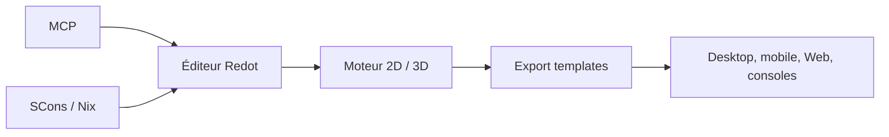

# Redot-Engine/redot-engine

> Moteur de jeu 2D et 3D multiplateforme avec éditeur, pour créer des jeux.

## Le problème
Créer un jeu demande un éditeur, un moteur et des exports pour chaque plateforme.

## Ce que ça fait vraiment
Il fournit un éditeur unifié pour des jeux 2D et 3D, avec export en un clic vers Linux, macOS, Windows, Android, iOS, le Web et des consoles. Le README signale une intégration IA via le Model Context Protocol.

## Comment c'est branché

Schéma simplifié d'après la fiche, sans diagramme fourni.

## Essayer
```bash
nix run .
```

## Coût et pièges
Gratuit. Des binaires officiels existent, sinon compilation avec SCons ou Nix (documentation externe). Le détail du MCP est renvoyé à une page non fournie.

## Ce que ce n'est pas
Ce n'est pas un outil d'IA : le MCP n'est qu'une option annexe. Le README ne décrit pas le lien exact avec Godot.

## Alternatives
Le README n'en nomme aucune.

## Pour toi
À ignorer : moteur de jeu sans rapport avec un travail data / IA / MLOps, hors prototypage de simulation.

